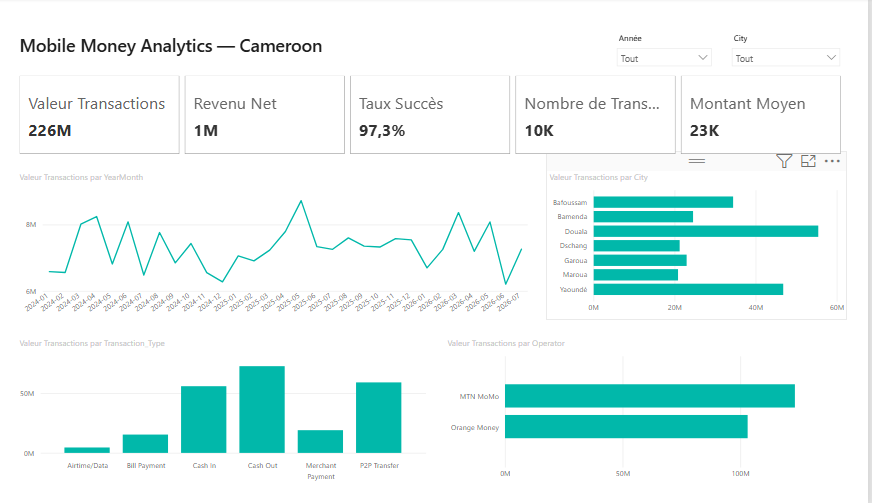
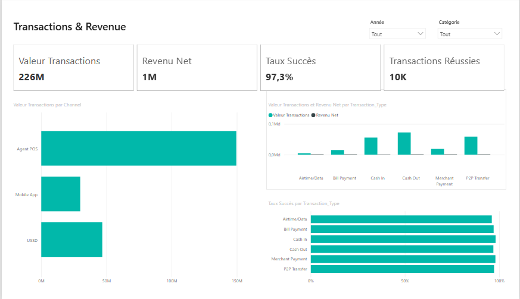
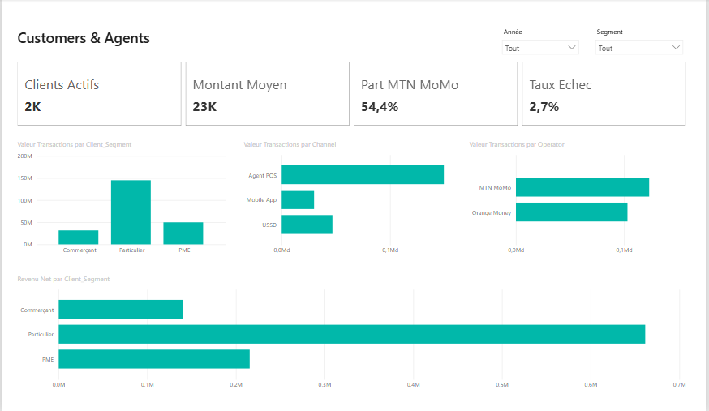
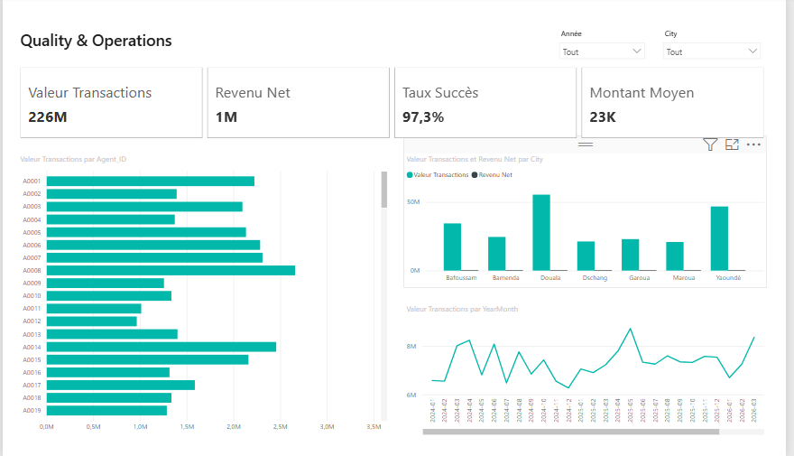

# 🇨🇲 Mobile Money Analytics Cameroon

Projet **Data Analytics / Business Intelligence end-to-end** consacré à l'analyse d'une plateforme Mobile Money fictive au Cameroun.

> **Question métier :** comment améliorer l'activité, le revenu net et la qualité de service d'une plateforme Mobile Money grâce aux données ?



## 🎯 Objectif du projet

Le projet transforme un jeu de données transactionnelles synthétiques en informations décisionnelles à l'aide de **Excel/CSV, SQLite, SQL, Python/Pandas, DAX et Power BI**.

Workflow :

**Données brutes → préparation → SQLite/SQL → analyse Python → KPI DAX → dashboard Power BI → recommandations métier**

> **Important :** toutes les données sont synthétiques. Elles ne représentent pas les performances, parts de marché ou statistiques réelles de MTN Cameroon, Orange Cameroon ou du marché Mobile Money camerounais.

## 📊 Jeu de données

- **10 000 transactions**
- Période : **1 janvier 2024 – 31 juillet 2026**
- Opérateurs simulés : **MTN MoMo** et **Orange Money**
- Villes : Douala, Yaoundé, Bafoussam, Dschang, Bamenda, Garoua, Maroua
- Segments : Particulier, PME, Commerçant
- Canaux : USSD, Mobile App, Agent POS
- Types : Cash In, Cash Out, P2P Transfer, Merchant Payment, Bill Payment, Airtime/Data

### KPI vérifiés sur le jeu synthétique

| KPI | Valeur |
|---|---:|
| Transactions | 10 000 |
| Taux de succès | 97,28 % |
| Valeur des transactions réussies | 226 335 400 FCFA |
| Frais générés | 1 299 080 FCFA |
| Commissions agents | 281 934 FCFA |
| Revenu net | 1 017 146 FCFA |
| Clients actifs | 2 458 |
| Agents actifs | 129 |
| Ville n°1 en valeur | Douala |

## 🔎 Questions métier

- Quels types de transactions génèrent le plus de valeur ?
- Quelles villes sont les plus actives ?
- Quels canaux ont les meilleurs taux de succès ?
- Quels motifs expliquent les échecs ?
- Quels agents traitent le plus de transactions ?
- Quels segments clients génèrent le plus de valeur ?
- Quels frais et commissions sont générés ?
- Quel est le revenu net après commissions agents ?
- À quelles heures l'activité est-elle la plus forte ?
- Comment la valeur des transactions évolue-t-elle dans le temps ?

## 💡 Quelques résultats du jeu synthétique

- **Cash Out** est le type de transaction qui génère la plus forte valeur réussie : **72 598 900 FCFA**.
- **MTN MoMo** représente environ **54,4 %** de la valeur réussie du jeu simulé.
- **Agent POS** est le canal le plus utilisé avec **5 289 transactions**.
- **Mobile App** possède le meilleur taux de succès parmi les trois canaux, à environ **97,9 %**.
- La première raison d'échec est **« Solde insuffisant »**, avec **93 échecs**.
- Le segment **Particulier** concentre la plus grande valeur réussie : **144 976 700 FCFA**.

Ces résultats décrivent uniquement le **dataset synthétique** du projet.

## 🛠️ Technologies

| Technologie | Utilisation |
|---|---|
| Excel / CSV | Données sources |
| SQLite | Base relationnelle |
| SQL | Agrégations, JOIN, CTE, fonctions de fenêtre |
| Python | Analyse et automatisation |
| Pandas | Manipulation de données |
| Matplotlib | Visualisation |
| Jupyter | Notebook analytique |
| Power BI | Dashboard interactif |
| DAX | KPI et mesures |
| GitHub | Versionnement et portfolio |

## 🗂️ Structure du dépôt

```text
Mobile-Money-Analytics-Cameroon/
│
├── README.md
├── PROJECT_QA.md
├── requirements.txt
├── .gitignore
│
├── data/
│   ├── README.md
│   ├── raw/
│   │   ├── mobile_money_analytics_cameroon.xlsx
│   │   └── mobile_money_transactions_cameroon.csv
│   └── database/
│       └── mobile_money_cameroon.db
│
├── notebooks/
│   ├── Projet_02_Mobile_Money_SQL_Python.ipynb
│   └── Projet_02_Mobile_Money_SQL_Python_EXECUTE.ipynb
│
├── sql/
│   ├── schema_database.sql
│   └── analyse_mobile_money.sql
│
├── powerbi/
│   ├── Mobile_Money_Analytics_Cameroon.pbip
│   ├── Mobile_Money_Analytics_Cameroon.Report/
│   ├── Mobile_Money_Analytics_Cameroon.SemanticModel/
│   ├── PowerBI_Mesures_DAX.txt
│   ├── OUVRIR_DANS_POWER_BI.txt
│   └── theme/
│
├── docs/powerbi/
└── images/
    ├── 01_executive_overview.png
    ├── 02_transactions_revenue.png
    ├── 03_customers_agents.png
    └── 04_quality_operations.png
```

## 🧮 SQL

Le fichier `sql/analyse_mobile_money.sql` couvre notamment :

- KPI globaux ;
- performance par opérateur ;
- types de transactions ;
- villes et canaux ;
- segments clients ;
- top clients et agents ;
- raisons d'échec ;
- activité horaire ;
- évolution mensuelle ;
- croissance mensuelle avec `LAG()`.

Exemple :

```sql
SELECT
    operator,
    COUNT(*) AS transactions,
    SUM(CASE WHEN status='Success' THEN amount_fcfa ELSE 0 END) AS valeur_fcfa,
    SUM(net_revenue_fcfa) AS revenu_net_fcfa
FROM fact_transactions
GROUP BY operator;
```

## 🐍 Python / Pandas

Les notebooks suivent le workflow :

**SQLite/SQL → Pandas → contrôles qualité → KPI → visualisations → recommandations métier**

- `Projet_02_Mobile_Money_SQL_Python.ipynb` : version source ;
- `Projet_02_Mobile_Money_SQL_Python_EXECUTE.ipynb` : version avec sorties enregistrées.

Les chemins vers la base SQLite sont relatifs au dépôt afin de faciliter l'exécution sur une autre machine.

## 📊 Dashboard Power BI

Le projet Power BI se trouve dans `powerbi/` et s'ouvre avec :

`Mobile_Money_Analytics_Cameroon.pbip`

Le rapport comporte quatre pages :

### 1. Executive Overview


### 2. Transactions & Revenue



### 3. Customers & Agents



### 4. Quality & Operations



Les fichiers locaux/cache de Power BI (`.pbi/`) sont volontairement exclus du dépôt.

## 📐 Principales mesures DAX

- Nombre de Transactions
- Transactions Réussies
- Transactions Échouées
- Taux Succès
- Taux Echec
- Valeur Transactions
- Montant Moyen
- Frais Générés
- Commissions Agents
- Revenu Net
- Clients Actifs
- Agents Actifs
- Part MTN MoMo
- Part Orange Money

Les définitions sont disponibles dans `powerbi/PowerBI_Mesures_DAX.txt`.

## 🚀 Exécuter l'analyse Python

Depuis la racine du dépôt :

```bash
python -m venv .venv
```

Sous Windows :

```bash
.venv\Scripts\activate
```

Puis :

```bash
pip install -r requirements.txt
jupyter notebook
```

Ouvrez ensuite un notebook dans le dossier `notebooks/`.

## ✅ Statut du projet

- [x] Dataset synthétique documenté
- [x] Données Excel et CSV
- [x] Base SQLite
- [x] Schéma SQL et vue analytique
- [x] Analyse SQL
- [x] Notebook Python source
- [x] Notebook exécuté
- [x] Power BI au format PBIP
- [x] Mesures DAX
- [x] 4 captures du dashboard
- [x] Fichiers locaux Power BI exclus
- [x] Documentation GitHub

## 👤 Auteur

**Mouliom Djidere Askanda**  
Data Analyst • Business Intelligence • Data / IA

## ⚠️ Disclaimer

Projet pédagogique et de portfolio. Toutes les données sont synthétiques et ne doivent pas être interprétées comme des données réelles d'opérateurs, de clients ou d'agents Mobile Money.
